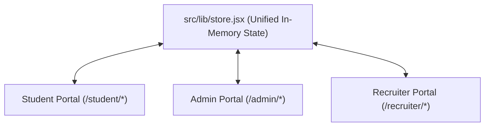

# 🏛️ CampusLink AI — Comprehensive System Specification, Design Architecture & Enhancement Guide

> **Document Version**: 2.0.0  
> **Target Audience**: Core Engineering Team, UI/UX Designers & Claude AI Prompting Engine  
> **Platform**: CampusLink AI (BPUT Hackathon PS10 Prototype)  
> **Status**: Production-Ready Frontend Build Verified (`npm run build` passing with 0 errors)

---

## 1. Executive Summary & Brand Philosophy

**CampusLink AI** is an intelligent, end-to-end Campus-to-Corporate Placement Management and Analytics Ecosystem. It was built to solve the widespread operational paralysis in college placement cells, which typically rely on fragmented WhatsApp groups, chaotic spreadsheets, missed deadlines, opaque shortlisting, and scheduling collisions.

### Core Product Objectives:
1. **Digitize & Unify**: Connect Students, Placement Cell Administrators, and Corporate Recruiters onto one synchronized, reactive platform.
2. **Transparent, Explainable AI**: Replace binary, black-box rejection/shortlisting decisions with human-understandable, weighted factor breakdowns and automated remediation roadmaps.
3. **Automated Resource Scheduling**: Detect venue collisions and interview panel double-booking automatically, providing single-click conflict mitigation.
4. **Early Warning Interventions**: Predict unplaced and at-risk students before the recruitment season ends and automate mentor assignments.
5. **Verified Lifecycle Tracking**: Track the post-selection journey from offer letter verification to documentation compliance and joining confirmation.

---

## 2. Design System Deep Dive: "Odisha Ink"

### 2.1 The Visual Narrative
Most placement portals are rendered in sterile corporate royal blue (`#1E40AF`) and white, while modern AI-generated prototypes default to glowing purple/violet gradients with glassmorphic cards and Inter typography. 

CampusLink AI rejects both clichés. It employs the **"Odisha Ink"** design system, inspired by the historical **Pattachitra** painting tradition of Odisha:
- Warm, earthy paper and parchment surfaces.
- Fine, hand-inked line dividers.
- Deep, solid carbon-ink typography.
- A single, warm **Ochre** accent color reminiscent of traditional mineral pigments.
- Crisp status signifiers (Jade for verified, Brick for alerts/conflicts).

This palette connects with BPUT judges from Odisha on a subconscious cultural level while radiating the warmth and restraint of a custom human-designed editorial tool.

---

### 2.2 Complete Color Token Matrix

| Token Name | Hex Code | Tailwind Token | Visual Description | Strict Usage Rules |
| :--- | :--- | :--- | :--- | :--- |
| **Bone** | `#F6F2E9` | `bg-bone`, `text-bone` | Warm cream parchment | The entire application background. Soft on projectors, avoids harsh white glare. |
| **Paper** | `#FFFDF8` | `bg-paper` | Bright clean card surface | All card containers, drawer surfaces, popovers, and table containers. |
| **Ink** | `#14161C` | `bg-ink`, `text-ink` | Deep carbon black | Primary typography, headers, dark sidebar, primary buttons, and active borders. |
| **Ink Soft** | `#5B5F6B` | `text-ink-soft` | Muted neutral graphite | Secondary descriptions, column headers, metadata tags, hints, and muted icons. |
| **Line** | `#E6DFCF` | `border-line` | Subtle warm border line | 1px borders across all cards, table row dividers, and tab underlines. |
| **Ochre** | `#E8A33D` | `bg-ochre`, `text-ochre` | Warm saffron / golden ochre | **The ONE primary accent.** Active nav markers, ScoreDial arc, sparkles, highlights. |
| **Ochre Tint** | `#FBEFD5` | `bg-ochre-tint` | Pale ochre wash | Background for pending badges, highlighted table rows, and explanation banners. |
| **Ochre Deep** | `#8A5A0B` | `text-ochre-deep` | Dark golden amber | High-contrast text on ochre-tint backgrounds. Text on Ochre is always Ink, never white. |
| **Jade** | `#1F8A63` | `text-jade`, `bg-jade` | Deep emerald green | Strictly for successful verification, approved records, and high-readiness badges. |
| **Jade Tint** | `#DDF1E8` | `bg-jade-tint` | Pale mint wash | Background container for approved statuses and verified credentials. |
| **Brick** | `#C4432F` | `text-brick`, `bg-brick` | Rich terracotta red | Strictly for rejected applications, scheduling conflicts, and at-risk warnings. |
| **Brick Tint** | `#F8E1DC` | `bg-brick-tint` | Pale terracotta wash | Background for conflict banners, rejected rows, and early warning flags. |

> [!IMPORTANT]
> **Strict Color Invariants**:
> - Never use blue, purple, magenta, or neon gradients.
> - Never use glassmorphism with heavy blur over content.
> - Text placed on top of `#E8A33D` (Ochre) must **always** be `#14161C` (Ink), never white.
> - Green and red are semantic tools, never decorative elements.

---

### 2.3 Typography System

The application pairs a literary display serif with a clean, humanist sans-serif:

1. **Display & Headings: `Fraunces` (Google Font)**
   - Variable optical size with weights 500, 600, 700.
   - Applied to: Main page headers (`h1`), section titles (`h2`), card headings (`h3`), big statistical metrics, and the brand wordmark.
   - Purpose: Imparts warmth, intentional editorial design, and distinguishes the portal from standard template apps.

2. **Interface & Body: `Manrope` (Google Font)**
   - Humanist sans-serif with weights 400, 500, 600, 700.
   - Applied to: Navigation links, body copy, table cell data, buttons, and form inputs.
   - Purpose: Highly readable at small font sizes (11px–14px), modern geometric proportions without the coldness of Inter.

3. **Tabular Numerals: `.tabular-nums`**
   - Enabled globally for numbers, scores, percentages, and currencies.
   - Ensures vertical alignment in data tables and prevents layout jitter when numbers count up.

```css
/* Typography Scale Sample */
h1 { font-family: 'Fraunces', serif; font-size: 32px; font-weight: 600; line-height: 1.15; }
h2 { font-family: 'Fraunces', serif; font-size: 24px; font-weight: 600; line-height: 1.25; }
h3 { font-family: 'Fraunces', serif; font-size: 18px; font-weight: 600; }
body { font-family: 'Manrope', sans-serif; font-size: 14px; color: #14161C; }
.label-caps { font-size: 11px; font-weight: 600; text-transform: uppercase; letter-spacing: 0.05em; color: #5B5F6B; }
```

---

### 2.4 Layout & Surface Architecture
- **8-Pixel Spacing Grid**: All padding, margins, and gaps adhere to multiples of 8px (`8px`, `16px`, `24px`, `32px`, `48px`).
- **Cards**: `bg-paper`, 1px solid `border-line`, rounded corners (`rounded-2xl` = `16px`), padding `p-6`, subtle shadow: `0 1px 2px rgba(20, 22, 28, 0.04)`.
- **Max Width**: Application main content viewport is constrained to `1180px` (or `1440px` for ultra-wide dashboards) with generous whitespace to prevent data crowding.
- **Custom Scrollbar**: Minimalist 7px width, transparent track, soft ink thumb with pill curvature.

---

## 3. Complete Information Architecture & Route Sitemap

```
├── /                               Public Landing Hub (Hero, Pipeline, Portals, Tech Architecture)
│
├── /student                        (Redirects to /student/overview)
│   ├── /student/overview           Student Readiness Dashboard & Interactive Skill Gap Engine
│   ├── /student/profile            Locked Academic Records, Skill Matrix & Resume Upload
│   ├── /student/drives             Placement Drives Browser with "Apply (AI Match)" Scanning
│   ├── /student/applications       Application Tracker, Typewriter Explanations & Offers
│   └── /student/interviews         Interview Schedule Timeline & Cell Preparation Tips
│
├── /admin                          (Redirects to /admin/command-center)
│   ├── /admin/command-center       Placement Directorate Command Center & Conversion Charts
│   ├── /admin/verification         Academic Transcript Audit Queue with PDF Preview Drawer
│   ├── /admin/recruiters           Corporate Partner Metrics & Campus Engagement Ratings
│   ├── /admin/drives               Drive Calendar with Overlap Visualizer & Conflict Resolver
│   ├── /admin/at-risk              Early Warning System with Faculty Mentor Assignment
│   └── /admin/offers               Offer Letters, Document Compliance & Notification Dispatch
│
└── /recruiter                      (Redirects to /recruiter/overview)
    ├── /recruiter/overview         Recruitment Dashboard & Selection Funnel Visualizer
    ├── /recruiter/jobs             Active Job Notification Forms (JNFs)
    ├── /recruiter/pipeline         AI Candidate Ranking (>85% Matches), Bio Drawer & Slots
    ├── /recruiter/slots            Weekly Interview Calendar Matrix (Mon–Fri x 4 slots)
    └── /recruiter/analytics        Hiring Funnel Analytics, Branch Distribution & Match Spread
```

---

## 4. Page-by-Page Detailed Blueprint

### 4.1 The Public Landing Hub (`/`)

#### Purpose:
The introductory gateway shown to judges before exploring deep portal features. It explains the end-to-end transformation in under 30 seconds.

#### Visual Structure & Sections:
1. **Top Header**:
   - Left: CampusLink wordmark in Fraunces bold with an Ochre dot and spark logo.
   - Center: Smooth scroll anchor links (*Pipeline*, *Portals*, *Architecture*, *Metrics*).
   - Right: Primary button: *"Launch System Demo"* (direct link to `/student/overview`).
2. **Hero Section**:
   - Pill badge: `BPUT Hackathon · Problem Statement 10 Prototype` in Ochre tint.
   - Headline: `"From campus to corporate, in one clear pipeline."` (64px Fraunces with an underlined serif emphasis on *"clear pipeline"*).
   - Subtitle: Clear explanation of how spreadsheets and chaotic communication are replaced.
   - Dual CTAs: *"Explore the Live Portals"* (scrolls to `#portals`) and *"See How the Pipeline Works"* (scrolls to `#pipeline`).
   - Background: Radial ochre ambient glow with a geometric SVG line pattern (`hero-grid-pattern`).
   - Bottom Trust Badges: Jade checkmarks for *Rule + AI Hybrid Matching*, *Conflict-Aware Scheduler*, *Transparent Shortlists*, and *Connected Multi-Portal State*.
3. **The 6-Step Pipeline Section (`#pipeline`)**:
   - 6 cards illustrating the PS10 lifecycle:
     1. *Readiness Profiling* (UserCheck icon)
     2. *AI Matching & Scoring* (Brain icon)
     3. *Conflict-Free Scheduling* (CalendarCheck icon)
     4. *Targeted Notifications* (BellRing icon)
     5. *Offer & Doc Tracking* (Award icon)
     6. *Predictive Analytics* (BarChart3 icon)
   - Staggered card entrance on scroll.
4. **Three Portals Section (`#portals`)**:
   - 3 large interactive cards representing the Student, Central Cell (Admin), and Recruiter views.
   - Hover effect: Card lifts -6px, border turns Ochre, right arrow slides forward.
   - Features 3 bulleted value propositions per role and an instant launch button.
5. **Under the Hood / Architecture Section (`#architecture`)**:
   - Inked dark section (`bg-ink text-bone`).
   - Three architectural pillars: *Rule + AI Hybrid Scoring*, *Semantic Match Embeddings*, and *Conflict-Aware Scheduling*.
   - Interactive SVG data-flow diagram: `Source Ingestion` $\rightarrow$ `Intelligence Layer` $\rightarrow$ `Scheduler` $\rightarrow$ `Reactive Store`.
6. **Metrics Counter Bar (`#impact`)**:
   - 4 count-up statistical cards:
     - 1,420 Registered Students (across 6 disciplines)
     - 42 Recruiter Partners (Tier-1 MNCs)
     - 78.4% Placement Rate (+12.8% YoY)
     - ₹34.0 LPA Highest CTC (Cloud Systems Engineer)

---

### 4.2 Student Portal

#### 1. Readiness Dashboard (`/student/overview`)
- **Banner**: Displays logged-in student (*Ananya Sharma*, B.Tech CSE, CGPA 8.80) with a live dynamic badge: `Verified by Placement Cell` (Jade) or `Pending Verification` (Ochre).
- **4 Metric Cards**:
  - *Eligible Drives*: 18 (based on CGPA filter)
  - *Active Applications*: Dynamic count from store
  - *Interviews Scheduled*: Real-time count of confirmed interviews
  - *AI Resume Score*: 88% (ATS parsed rating)
- **Placement Readiness Card (Left Column)**:
  - Custom SVG **ScoreDial**: A 210px diameter semicircle dial that dynamically animates from 0 to current readiness score (72/100).
  - **Readiness Progression Ladder**: A 4-step horizontal track:
    $$\text{Not Ready } (<65) \longrightarrow \text{Developing } (65-79) \longrightarrow \text{Ready } (80-89) \longrightarrow \text{Highly Employable } (90+)$$
  - Active step indicator marker with an animated pinging pulse ring.
- **Skill Gaps for Target Role (Right Column - Signature Feature)**:
  - Contextualized for *Microsoft SDE* (Benchmark: 80+ Ready).
  - 4 interactive chips:
    - *Cloud Infrastructure (AWS/Azure)* (+4 pts)
    - *Distributed System Design* (+3 pts)
    - *Mock Coding Interviews (Hard Algorithmic)* (+5 pts)
    - *Certified Kubernetes / DevOps Foundations* (+2 pts)
  - **Interaction**: Clicking any chip toggles its status to "In Progress", draws an SVG checkmark inside the chip, animates the ScoreDial arc to the new score, and if a threshold is crossed (e.g. 72 to 80), the ladder marker smoothly slides to the next tier!

#### 2. Profile & Verified Credentials (`/student/profile`)
- **Locked Academic Records**:
  - Read-only card with a security lock icon.
  - Displays College ID (`220101045`), Discipline (CSE), Verified CGPA (`8.80 / 10.0`), and Active Backlogs (`0`).
  - Labeled `Locked & Audited by Central Placement Cell`.
- **Technical Stack & Skills Matrix**:
  - Interactive `TagInput` component.
  - Tags (`React`, `Node.js`, `Python`, `PostgreSQL`, `Tailwind CSS`) pop in and out with Framer Motion layout springs.
  - Students can add new skills by typing and pressing Enter.
- **Resume Upload & Audit**:
  - PDF file attachment picker with file size and type preview.
  - ATS verification badge (88% compliance).
- **Submit for Verification**:
  - Simulates a 900ms server audit request.
  - Dispatches toast notification.
  - Shifts student status to `Pending Verification`.
  - Appends an audit task to the Admin's Verification Queue!

#### 3. Campus Placement Drives (`/student/drives`)
- **Stream Tabs**: *All Streams*, *IT / Software*, *Core Engg*.
- **Search Bar**: Instant filtering by company or role.
- **Drive Cards**:
  - Company name, stream tag, package range (e.g. `16.5 - 21.0 LPA`), drive date, venue, cut-off CGPA, and required skill chips.
  - Detects conflict status (if a drive has a schedule collision, it displays a terracotta alert badge).
- **Apply (AI Match) Button (Signature Animation)**:
  - Clicking triggers an animated state:
    1. Button text becomes *"Matching..."* with an animated spinner and sparkle icon.
    2. A thin, horizontal Ochre laser scan line sweeps across the entire card container (0.85s).
    3. The button transforms into an AI Fit Badge (e.g. `72% Match` or `88% Match`).
    4. Automatically adds the application to the student's records and pushes the student into the Recruiter's talent pipeline.

#### 4. Applications & Placement Status (`/student/applications`)
- **Two Sub-Tabs**: *My Applications* and *Verified Offers & Docs*.
- **Expandable Application Accordion**:
  - Shows Company, Role, CTC, Status badge (*Shortlisted*, *Rejected*, *In Review*), and Fit Score percentage.
  - **On Expand (Signature Animation)**:
    - **Typewriter Effect**: The AI explanation text types itself out character-by-character at 20ms per letter.
    - **Factor Breakdown Bars**: Once typed, 5 factor weight bars fill sequentially from 0% to their respective values:
      1. *Skill & Tech-Stack Alignment* (40% weight)
      2. *CGPA & Academic Consistency* (20% weight)
      3. *Mock Technical Interview* (20% weight)
      4. *Project Relevance & GitHub* (10% weight)
      5. *Cloud Certifications* (10% weight)
    - **Color Coded Bars**: Jade for $\ge 80\%$, Ochre for $60-79\%$, Brick for $<60\%$.
    - **Remediation Action**: If rejected, an actionable box slides in with a link to *"Open Notion Remediation Roadmap $\rightarrow$"*.
- **Verified Offers Tab**:
  - Cards for accepted/offered packages with CTC, joining dates, and document verification checklists.

#### 5. Interview Schedule (`/student/interviews`)
- **Vertical Timeline**:
  - Upcoming interview rounds with animated timeline nodes on a left border track.
  - Displays company, date, time slot, interview mode (Virtual Teams / On-Campus Lab), and assigned assessment panel.
  - Dynamically populates whenever a corporate recruiter books a candidate from the Recruiter portal!
- **Placement Cell Tips Card**:
  - Guidelines on technical review, the STAR behavioral framework, and audio/video prerequisites.

---

### 4.3 Central Placement Cell (Admin Portal)

#### 1. Command Center (`/admin/command-center`)
- **Header Action**: *"Authorize New Drive"* button opening a drawer with conflict pre-validation.
- **4 Macro Metrics**: Eligible Students (1,420), Active Recruiters (42), Overall Placed % (78.4%), Highest CTC (₹34.0 LPA).
- **Recharts Analytics Engine**:
  - **Chart 1 (Bar)**: Branch-Wise Placement Conversion rate (CSE 82%, IT 76%, ECE 64%, EEE 58%, ME 49%, CE 41%) with custom Ochre bars and themed tooltip.
  - **Chart 2 (Line)**: 5-year historical package growth (2022 to 2026) comparing Average CTC vs Highest CTC with dashed ink line and solid ochre points.
- **Offers Pipeline Strip**: Quick overview pill showing counts of Offered, Accepted, Pending, and Missing Docs.

#### 2. Academic Verification Queue (`/admin/verification`)
- **Queue Table**: Displays students requesting academic audits, their reported CGPA, discipline, and submission date.
- **PDF Audit Drawer**: Clicking *"View Transcript PDF"* slides open an audit panel with an embedded official BPUT transcript seal and DigiLocker validation tag.
- **Approve / Reject Action (Signature Animation)**:
  - **Approve**: The table row flashes `jade-tint`, a green checkmark is drawn via SVG stroke inside the action cell, the row collapses its height to 0 after 650ms, and the pending count decrements. The student's badge across the app updates to `Verified`!
  - **Reject**: The row shakes horizontally 3 times, flashes `brick-tint`, and collapses.
  - **Empty State**: When all items are approved, an animated `All caught up!` checkmark illustrates that the queue is clear.

#### 3. Recruiter Partners (`/admin/recruiters`)
- Table of 8 corporate hiring partners (Microsoft, TCS, Cognizant, Infosys, L&T, Tata Motors, Tech Mahindra, Capgemini).
- Columns for drives hosted, students hired, average CTC, and visual engagement percentage progress bars.

#### 4. Drives Calendar & Conflict Resolver (`/admin/drives`)
- **Automated Conflict Detector**:
  - Detects that **Cognizant Technology** requested Nov 02 (09:00 - 12:00) in **Computing Lab 4**, clashing with **Tech Mahindra** (10:00 - 13:00).
- **Timeline Visualizer (Signature Feature)**:
  - An interactive 9:00 to 17:00 time axis showing horizontal slot blocks.
  - The 2-hour collision window (10:00 - 12:00) is rendered with a pulsing, hatched brick-red overlay labeled `CLASH (10:00-12:00)`.
- **1-Click Auto-Mitigate**:
  - Clicking *"Resolve Conflict"* slides the Cognizant bar smoothly into an open window (`14:00 - 17:00, Computing Lab 2`).
  - The red clash hatching fades away.
  - The conflict banner morphs into a Jade celebration banner: `Resolved: moved to 14:00 - 17:00, Computing Lab 2`.
  - The drive status across Student and Admin portals turns from `Conflict` to `Verified`!

#### 5. Early Warning & At-Risk Analytics (`/admin/at-risk`)
- Proactive predictive table listing students flagged with low CGPA ($<7.0$), weak mock interview scores ($<60$), or 3 consecutive drive rejections.
- Displays a visual Risk Severity Bar (e.g. 92% Critical, 84% High).
- **Assign Mentor (Signature Interaction)**:
  - Clicking opens an inline mentor picker popover (*Dr. R. Mishra*, *Prof. P. K. Sahoo*, *Dr. S. Panda*).
  - Selecting a mentor smoothly morphs the button into an emerald badge: `Mentor: Dr. R. Mishra` and dispatches a notification.

#### 6. Offers & Documentation Compliance (`/admin/offers`)
- Tracks the post-selection funnel (Offered, Accepted, Deferred, Withdrawn).
- Displays document completion ratios (e.g. `3/4 verified`) with segmented mini progress meters.
- **Send Reminder Button**: Dispatches an automated email/SMS prompt and sets `reminderSent: true`, reflecting in the student's offer checklist.

---

### 4.4 Corporate Recruiter Portal

#### 1. Talent Overview (`/recruiter/overview`)
- Active drive banner for *Microsoft India University Recruitment* (342 applicants).
- **Hiring Funnel Visualizer**:
  - 4 horizontal tapered progress bars representing candidate conversion:
    $$\text{Total Applicants (342)} \longrightarrow \text{AI Match } >85\% \text{ (48)} \longrightarrow \text{Interviews (12)} \longrightarrow \text{Offers (16)}$$
  - Each bar animates sequentially on scroll with an Ochre gradient fill.
- **Post JNF Drawer**: Form to configure new roles, CTC brackets, cut-off CGPA, and required skill tags.

#### 2. Active Job Postings (`/recruiter/jobs`)
- Cards for open postings (*SDE-1*, *Cloud Solutions Architect Trainee*, *Data & Applied AI Fellow*).
- Displays application counts, qualified candidate pools, and deadlines.

#### 3. Candidate Pipeline & AI Match (`/recruiter/pipeline`) *(Hero Recruiter Screen)*
- **Stream Tabs**: Filter by *All Qualified*, *CSE / IT*, or *ECE*.
- **Semantic Match Ranking**:
  - Candidates are automatically ranked descending by their `aiMatch` score ($94\%$ down to $72\%$).
  - High matches feature an Ochre sparkle with an ambient pulsing shimmer.
- **View Bio Drawer (Signature Animation)**:
  - Clicking slides open a 560px profile drawer.
  - Top callout highlights the AI Match justification sentence:
    > *"Highly Recommended: Candidate possesses verified proficiency in **React**, **Python**, and **Data Structures**, exceeding the required mock benchmarks..."*
  - An animated Ochre underline draws itself sequentially under the words **React**, **Python**, and **Data Structures**!
  - Verified skill chips pop in with staggered springs.
  - Clean resume skeleton viewer.
- **Schedule Slot Popover**:
  - Opens a menu of conflict-free slots on Nov 05, 2026.
  - Automatically identifies and disables conflicting slots (*"Clashes with TCS Drive in Lab 4"*).
  - Booking a slot locks the candidate, updates the scheduled count, and syncs immediately to the student's personal interview calendar!

#### 4. Interview Slots Grid (`/recruiter/slots`)
- A weekly interactive matrix (Monday to Friday $\times$ 4 daily time slots).
- Booked candidate cards show names and roles with verified green checkmarks.
- Empty slots can be clicked to reserve an immediate interview window.

#### 5. Hiring Analytics (`/recruiter/analytics`)
- Recharts visualizations for:
  - *Applicants by Branch* (CSE, IT, ECE, Others).
  - *AI Match Score Distribution Histogram* (90-100%, 80-89%, 70-79%, 60-69%, <60%).
- Key metric cards: Average AI Match (78.2%), Offer Acceptance Rate (88.5%), and Time-to-Hire (12 Days).

---

## 5. Global Layouts, Shells & System-Wide UI

### 5.1 AppShell Architecture (`src/components/layout/AppShell.jsx`)
- **Desktop Sidebar (250px)**:
  - Deep Ink background (`#14161C`) with soft bone text.
  - Active item features an animated 3px Ochre pill marker sliding vertically between routes using Framer Motion's `layoutId="sidebarActiveMarker"`.
  - Icon-only collapse below 1024px; mobile drawer with slide-in animation.
- **Sticky Header**:
  - Left: Brand mark with sparkling icon + Tenant context subtext (Student, Admin Directorate, or Recruiter TA).
  - Center: Global Search trigger with `Ctrl+K` keyboard shortcut pill.
  - Right:
    - **Demo Role Switcher Segmented Control**: 3-button pill (`Student | Admin | Recruiter`) allowing judges to jump between portals in one click.
    - **Notification Bell**: Features an unread Ochre dot and a subtle swing animation whenever a new event is emitted.
    - **User Avatar**: Inked circular badge with initials.

### 5.2 Global Command Palette (`Ctrl+K`) (`CommandPalette.jsx`)
- Triggered by pressing `Ctrl+K` (or `Cmd+K` on Mac) anywhere in the application or clicking the search bar.
- Centered modal dialog with backdrop blur.
- Live filtering across all portal destinations, actions, drives, and student verification tasks.
- Keyboard navigation (Arrow Up/Down, Enter to select, Escape to dismiss).

### 5.3 Real-Time Notification Popover (`NotificationPopover.jsx`)
- Opens from the header bell.
- Groups real-time platform events into categories: *Shortlisting*, *Drives*, *Deadlines*, and *Offers*.
- Displays relative timestamps (*"2 hours ago"*, *"Just now"*), unread dot indicators, and a *"Mark all read"* action.

### 5.4 Toast Notification Dispatcher (`src/components/ui/Toast.jsx`)
- Built on React Context (`ToastProvider` + `useToast`).
- Fixed bottom-center presentation with a gentle slide-up spring (`y: 16 -> 0`).
- Auto-dismisses after 3.2 seconds.
- Four semantic color tones: Jade (success), Brick (alert), Ochre (pending), Ink (neutral).

### 5.5 React Error Boundary (`src/components/ui/ErrorBoundary.jsx`)
- Wraps the entire application tree.
- Prevents component render crashes from unmounting the page.
- Renders an in-theme recovery card with an *"Reload Page"* button in the Odisha Ink palette.

---

## 6. Shared Reactive State & Mock API Architecture

### 6.1 Reactive Store (`src/lib/store.jsx`)
The demo uses a unified React Context store with live cross-portal event propagation:



#### The 5 Live Cross-Portal Synchronizations:
1. **Admin Verification $\rightarrow$ Student Badge**:
   When Admin clicks "Approve" on Ananya Sharma in `/admin/verification`, `currentStudent.verified` becomes `true`. Navigating to `/student/overview` instantly shows the green `Verified by Placement Cell` badge and a confirmation notification.
2. **Conflict Resolution $\rightarrow$ Schedule Sync**:
   When Admin clicks "Resolve Conflict" on the Cognizant drive in `/admin/drives`, the drive slot is updated to `14:00 - 17:00, Lab 2`. The new slot appears in `/student/drives` and the Admin calendar.
3. **Student Application $\rightarrow$ Recruiter Pipeline**:
   When Student applies to a drive in `/student/drives`, the applicant is pushed into `pipeline` in `/recruiter/pipeline` with their calculated AI Fit Score.
4. **Recruiter Slot Booking $\rightarrow$ Student Calendar**:
   When Recruiter books an interview slot for a candidate in `/recruiter/pipeline`, the interview is automatically inserted into `studentInterviews` in `/student/interviews`.
5. **Admin Offer Reminder $\rightarrow$ Student Checklist**:
   When Admin clicks "Send Reminder" in `/admin/offers`, the student's offer record flags `reminderSent: true` and shows a "Reminder received from Cell" badge.

---

### 6.2 Mock API Layer (`src/api/index.js`)
Components do not write directly to data files. Every view calls asynchronous service functions:
- `studentApi`: `getProfile()`, `submitProfile()`, `getDrives()`, `applyToDrive()`, `getApplications()`, `getInterviews()`
- `adminApi`: `getVerificationQueue()`, `approveStudent()`, `rejectStudent()`, `getDrives()`, `resolveConflict()`, `getAtRiskStudents()`, `assignMentor()`, `getRecruiterPartners()`
- `recruiterApi`: `getPipeline()`, `scheduleSlot()`, `getAnalytics()`
- `offersApi`: `getOffers()`, `sendReminder()`
- `notificationsApi`: `getNotifications()`

Every call simulates network latency (400ms–700ms) and returns deep-cloned JSON objects. **When the backend team finishes their REST/GraphQL API, only this file needs to be modified.**

---

## 7. Current Animation Engine & Mechanics

### 7.1 Motion Parameters
- **Physics Easing**: `cubic-bezier(0.22, 1, 0.36, 1)` (snappy ease-out with smooth deceleration).
- **Durations**:
  - Micro-interactions: `150ms` (button hovers, tap feedback)
  - Standard transitions: `300ms` (drawers, tab underlines, popovers)
  - Scene reveals: `700ms`–`900ms` (ScoreDial sweep, timeline slide)
- **GPU Rules**: Only `transform`, `opacity`, and SVG `strokeDashoffset` / `strokeDasharray` are animated to ensure 60fps performance on laptops and projectors.
- **Accessibility**: All components check Framer Motion's `useReducedMotion()`. If reduced motion is requested, transitions resolve instantaneously without looping effects.

### 7.2 Catalog of Signature Animations

| Location | Trigger | Signature Animation Behavior |
| :--- | :--- | :--- |
| **Landing Hero** | Page Load | Headline reveals word-by-word with a clipping mask; ambient ochre glow breathes in the background. |
| **Student Overview** | Click Gap Chip | Chip checks with SVG stroke animation; ScoreDial sweeps arc from 72 to 80; ladder marker slides to "Ready" with a pulse ring. |
| **Student Drives** | Click Apply | Button displays "Matching..."; an Ochre laser scan line sweeps horizontally across the card (0.85s); button morphs into a fit score badge. |
| **Student Applications** | Expand Row | AI explanation text types out dynamically (20ms/char); 5 factor breakdown bars fill sequentially with staggered delays. |
| **Admin Verification** | Click Approve | Row flashes `jade-tint`, draws a green SVG checkmark, then smoothly collapses its height to 0 (600ms); pending count decrements. |
| **Admin Verification** | Click Reject | Row shakes horizontally ($\pm 8\text{px}$ spring), flashes `brick-tint`, and collapses. |
| **Admin Drives** | Click Resolve Conflict | Cognizant timeline bar slides horizontally from Lab 4 to Lab 2; red clash hatching fades out; status banner morphs from brick to jade. |
| **Admin At-Risk** | Assign Mentor | Mentor selection button morphs into an emerald chip (`Mentor: Dr. R. Mishra`) with a slide-in spring. |
| **Recruiter Pipeline** | Tab Switch | Candidate rows re-order with physical layout springs (`layoutId`). |
| **Recruiter Bio** | Open Bio Drawer | Drawer slides from right; three key technical skills (*React*, *Python*, *Data Structures*) have an Ochre underline drawn underneath them sequentially. |
| **Global AppShell** | Route Change | Sidebar active marker slides between items using layout springs; page enters with fade and 8px upward rise. |
| **Notification Bell** | State Change | Bell icon rocks gently ($-12^\circ \rightarrow +12^\circ \rightarrow 0^\circ$, 500ms) when a cross-portal notification arrives. |

---

## 8. Master Enhancement Roadmap (Guide for Claude Prompts)

This section provides concrete directions for the user and Claude to plan the **next wave of UI/UX enhancements, visual polish, and advanced animations**:

### Phase A: Next-Level Micro-Interactions & Visual Polish
1. **Interactive Cursor / Glow Trail**:
   - Add a subtle, low-opacity Ochre spotlight glow that follows the mouse cursor on cards and the landing page hero.
2. **Audio / Sound Design (Tactile Feedback)**:
   - Optional, tasteful sound effects using the Web Audio API (synthetic subtle click on tab change, soft success chime on conflict resolved, gentle pop when skill chip is clicked).
3. **Interactive Confetti on Offer Acceptance**:
   - Canvas-based confetti burst utilizing the Odisha Ink color palette (Ochre, Jade, and Bone particles) when an offer is marked as "Accepted".
4. **Animated SVG Crest / University Emblem**:
   - An interactive geometric BPUT university seal in the header or landing page with rotating SVG orbit lines.

---

### Phase B: Advanced AI & Visualization Capabilities
1. **Interactive Student Readiness Spider / Radar Chart**:
   - Add a 6-axis Recharts or SVG Radar Chart on `/student/overview`:
     - Axis: *Core DSA*, *System Architecture*, *Communication Skills*, *Academic Consistency*, *Verified Projects*, *Industry Certifications*.
     - Overlay the student's polygon against the recruiter's minimum benchmark polygon.
2. **Candidate Comparison Mode (Recruiter Portal)**:
   - Checkbox selection in `/recruiter/pipeline` allowing a side-by-side modal comparison of 2 or 3 candidates with skill diff highlights.
3. **Live AI Assistant Floating Drawer / Chatbot**:
   - A floating pill button in the bottom right (*"CampusLink AI Assistant"*).
   - Students can ask questions like: *"Why was I rejected for Microsoft SDE?"* or *"What skills do I need for TCS Digital?"* with simulated streaming answers.
4. **Heatmap Calendar for Placement Season**:
   - A GitHub-style intensity heatmap on the Admin Command Center showing placement drive density across the 90-day season.

---

### Phase C: Polish for Live Hackathon Presentation
1. **"Tour Mode" / Guided Demo Walkthrough**:
   - A button in the header (*"Start 90-Second Demo Walkthrough"*) that highlights each required feature in sequence with tooltips pointing judges to the key innovations.
2. **Exportable PDF Report Generator**:
   - Add a *"Download Official Placement Audit Report (PDF)"* button in the Admin portal that compiles a printable summary of the season's analytics.
3. **Dark Mode Variant ("Night Lagoon" / Option B from design spec)**:
   - An optional theme toggle switching from the warm Bone background to deep forest lagoon (`#0B1714` background with lime accent `#C9F25B`).

---

## 9. Summary for Claude Prompting

When pasting this document into Claude to generate future enhancement prompts:
- Instruct Claude to strictly maintain the **Odisha Ink** token system (`bone`, `paper`, `ink`, `line`, `ochre`, `jade`, `brick`).
- Direct Claude to build on top of `src/lib/store.jsx` to preserve real-time cross-portal data synchronization.
- Emphasize that all animations must use **Framer Motion** with GPU-accelerated attributes (`transform`, `opacity`, and SVG stroke properties).
- Ensure that the single-accent design constraint (Ochre as the only accent color) remains intact.

