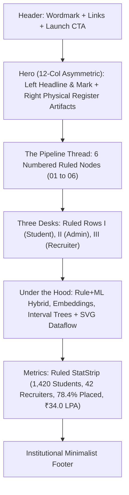

# 🏛️ CampusLink AI — Complete System Specification & Architecture Blueprint
## The Institutional Placement Register ("The Register" Identity · v3.0)

> **Document Version**: 3.0.0 (Unslop Edition)  
> **Platform**: CampusLink AI (BPUT Hackathon PS10 Prototype)  
> **Aesthetic Theme**: "The Register" / Odisha Ink Editorial System  
> **Current Build Status**: Production Ready (`npm run build` passing with 0 errors, 0 warnings)  
> **Repository Branch**: `main` (clean local commit `59d57de`)

---

## 1. Executive Summary & Brand Identity: "The Register"

### 1.1 The Concept
CampusLink AI has been architected not as another generic SaaS web application, but as an **institutional placement register that learned to explain itself**. 

In university placement directorates and Indian administrative offices, real governance runs on **ruled paper ledgers, official stamped approvals, and contextual margin notes**. CampusLink AI captures this physical, trustworthy authority while infusing it with modern machine learning intelligence:
- **Ruled, Not Boxed**: Content breathes directly on parchment, structured by clean 1px hairline rules rather than claustrophobic card grids.
- **Official Decision Stamps**: Key authorizations (`VERIFIED`, `REJECTED`, `SHORTLISTED`, `CLASH`, `RESOLVED`, `ACCEPTED`, `LOCKED`) are stamped in mono caps with a physical -2° rotation and spring thud.
- **Reviewer Margin Notes**: AI explanations appear as handwritten-style italic margin notes where key phrases receive an animated amber highlighter swipe (`<Mark>`).
- **Precision Data Monospace**: Roll numbers, CTC brackets, timestamps, and match scores are typeset in `IBM Plex Mono` with tabular numerals.
- **Tactile Paper Grain**: The entire application sits on an archival bone parchment with a 4% subtle fractal noise grain texture.

---

## 2. Design System Tokens & Physical Metaphors

### 2.1 Color Tokens ("Odisha Ink" Palette)

The platform strictly uses the **Odisha Ink** palette, inspired by traditional Pattachitra mineral pigments. It strictly bans purple/blue AI gradients, neon glows, and glassmorphic card blurs.

| Token | Hex Value | Tailwind Class | Semantic Application |
| :--- | :--- | :--- | :--- |
| **Bone** | `#F6F2E9` | `bg-bone`, `text-bone` | Physical parchment page background. |
| **Paper** | `#FFFDF8` | `bg-paper` | Floating objects only (record slips, drawers, popovers, score dial). |
| **Ink** | `#14161C` | `bg-ink`, `text-ink` | Deep carbon typography, headers, dark sidebar, primary buttons. |
| **Ink Soft** | `#5B5F6B` | `text-ink-soft` | Graphite metadata, column headers, secondary text, muted indicators. |
| **Line** | `#E6DFCF` | `border-line`, `bg-line` | 1px hairline rules, dividers, and subtle borders. |
| **Ochre** | `#E8A33D` | `bg-ochre`, `text-ochre` | **The ONE primary accent.** Match bars, timeline threads, highlighter swipes. |
| **Ochre Tint** | `#FBEFD5` | `bg-ochre-tint` | Wash background for pending tags and explanation containers. |
| **Ochre Deep** | `#8A5A0B` | `text-ochre-deep` | High-contrast amber text on ochre-tint backgrounds. |
| **Jade** | `#1F8A63` | `text-jade`, `border-jade` | Strictly for approved credentials, verified drives, and accepted offers. |
| **Jade Tint** | `#DDF1E8` | `bg-jade-tint` | Light mint wash container for positive audit authorizations. |
| **Brick** | `#C4432F` | `text-brick`, `border-brick` | Strictly for rejected applications, room collisions, and at-risk flags. |
| **Brick Tint** | `#F8E1DC` | `bg-brick-tint` | Terracotta wash container for clash alerts and risk warnings. |

> [!NOTE]
> **Purity Invariant**: Text placed on top of Ochre is **always Ink (`#14161C`)**, never white. Ochre is applied as small, high-density solid areas (marker lines, gauge needles, stamps), never as large background cards.

---

### 2.2 Typography Hierarchy

```
Display / Headings  ──▶ Newsreader (optical variable serif, 400/500/600 + italic)
UI & Body Text      ──▶ Instrument Sans / Manrope (humanist sans, 400/500/600)
Data & Labels       ──▶ IBM Plex Mono (precision monospace, 400/500/600)
```

1. **`Newsreader` (Headings & Big Numerals)**:
   - Page Titles: `Newsreader 36px / 1.08`, font-weight 400.
   - Numerical Readouts: `Newsreader 48px – 56px`, tabular numbers.
   - Lede Statements: `Newsreader italic 17px – 18px`, text-ink-soft.
2. **`Instrument Sans` (Interface Elements)**:
   - Body copy: 14px – 15px with 1.6 line height.
   - Button text: 12px – 13px, font-medium, letter-spacing +0.02em.
   - Table text: 13px.
3. **`IBM Plex Mono` (Precision Data)**:
   - Section context tags: `10.5px`, uppercase, tracking `0.16em` (`01 · STUDENT DESK`).
   - Identifiers: Roll numbers (`220101045`), college IDs, CTC brackets (`16.5 - 21.0 LPA`).
   - Timestamps, drive dates, fit score readouts (`FIT 94%`), and decision stamp copy.

---

### 2.3 Physical Surface Hierarchy

Instead of nesting cards inside cards, the interface utilizes three clean surface layers:
- **Level 0 (Parchment Page)**: `bg-bone` with a fixed, pointer-events-none 4% SVG fractal noise grain overlay (`body::before`).
- **Level 1 (Ruled Content Sections)**: Zero background, zero border radius. Sections sit directly on the parchment, bounded only by 1px hairline rules (`Rule.jsx`).
- **Level 2 (Tactile Floating Objects)**: `object={true}` on `Card.jsx`. Used selectively for floating physical slips: Drawer panels, popovers, the Command Palette, the ScoreDial instrument box, and authenticated offer slips (`bg-paper`, 10px radius, 1px line border, `shadow-object`).
- **Radii Standards**: Controls (`rounded-control` = `6px`), Floating Objects (`rounded-object` = `10px`), Stamps (`rounded-stamp` = `3px`). Rounded-2xl and rounded-3xl are strictly banned.

---

## 3. The Unslop Component Library

### 3.1 [`Stamp.jsx`](file:///c:/Users/zahid/OneDrive/Desktop/Hackathons/BPUT2026/src/components/ui/Stamp.jsx) — Official Decision Stamp
- **Visuals**: `font-mono text-[10.5px] uppercase tracking-[0.14em] font-semibold border-[1.5px] rounded-[3px] px-2 py-0.5 select-none -rotate-2`.
- **Tones**: Jade (`VERIFIED`, `APPROVED`, `RESOLVED`, `ACCEPTED`), Brick (`REJECTED`, `CLASH`, `WITHDRAWN`), Ochre (`SHORTLISTED`, `OFFERED`), Ink (`LOCKED`).
- **Physics**: When an action occurs (e.g. Admin clicks Approve), the stamp lands with a scale spring ($1.5 \rightarrow 1.0$), slight rotational tilt ($-8^\circ \rightarrow -2^\circ$), and opacity transition, simulating a physical rubber stamp impact.

### 3.2 [`Mark.jsx`](file:///c:/Users/zahid/OneDrive/Desktop/Hackathons/BPUT2026/src/components/ui/Mark.jsx) — Animated Highlighter Swipe
- Wraps key competencies inside AI explanations (e.g., `<Mark>React</Mark>`, `<Mark>Python</Mark>`, `<Mark>Data Structures</Mark>`).
- Renders an amber Ochre highlight block covering the lower 55% of the text.
- Animates via Framer Motion with `scaleX: 0 -> 1` originating from the left (`originX: 0`) over 500ms, recreating the visual of a reviewer running an amber highlighter over paper.

### 3.3 [`MarginNote.jsx`](file:///c:/Users/zahid/OneDrive/Desktop/Hackathons/BPUT2026/src/components/ui/MarginNote.jsx) — Reviewer Margin Note
- Renders a clean left-bordered margin column (`border-l-2 border-ochre` or `border-line`).
- Top label: `font-mono text-[10px] uppercase tracking-[0.14em] font-semibold text-ink-soft`.
- Body: `font-serif italic text-sm text-ink/90 leading-relaxed max-w-[65ch]`.

### 3.4 [`StatStrip.jsx`](file:///c:/Users/zahid/OneDrive/Desktop/Hackathons/BPUT2026/src/components/ui/StatStrip.jsx) — Ruled Metric Bar
- Replaces generic 4-card metric blocks with an institutional ruled register bar.
- Top and bottom bounded by 1px hairline rules; metric items separated by vertical hairlines.
- Features: Mono uppercase category labels, large `Newsreader 48px–56px` count-up numerals, and one-line context hints.

### 3.5 [`Masthead.jsx`](file:///c:/Users/zahid/OneDrive/Desktop/Hackathons/BPUT2026/src/components/ui/Masthead.jsx) — Editorial Page Header
- Provides consistent, authoritative framing on every screen:
  - Mono context slug: `01 · STUDENT DESK · ROLL 220101045`
  - Page title: `Newsreader 36px`
  - One-sentence italic lede: `Newsreader italic 17px`
  - Action slot on the right
  - Bottom hairline rule (`Rule.jsx`) separating header from page data.

### 3.6 [`ScoreDial.jsx`](file:///c:/Users/zahid/OneDrive/Desktop/Hackathons/BPUT2026/src/components/ui/ScoreDial.jsx) — v2 Physical Instrument
- Custom SVG semicircle instrument gauge (230px diameter):
  - **61 Engraved Tick Marks**: Every 3 degrees spanning $180^\circ$, with every 10th tick lengthened and labeled (`0`, `50`, `100`).
  - **3px Background Track**: Clean line-color arc.
  - **5px Solid Ochre Arc**: Represents calculated student readiness.
  - **Physical Rotating Needle**: 1.75px ink needle pivoting on a 4.5px circular hub that swings smoothly with spring overshoot (`needleAngle: -90° -> +90°`).
  - **Center Readout**: Large `Newsreader 48px` numeral counting in real-time, accompanied by the mono level name (`DEVELOPING`, `READY`).

### 3.7 [`JudgeGuide.jsx`](file:///c:/Users/zahid/OneDrive/Desktop/Hackathons/BPUT2026/src/components/layout/JudgeGuide.jsx) — Judge's 90-Second Walkthrough
- Discrete floating pill fixed in the bottom-left corner: `GUIDE 0/6`.
- Clicking expands an L2 paper slip listing the 6 critical hackathon evaluation steps:
  1. *Adjust skill gap chip* $\rightarrow$ verifies dynamic instrument dial & progression ruler.
  2. *Apply (AI Match) on Microsoft SDE* $\rightarrow$ verifies laser scan line & typewriter feedback.
  3. *Audit & stamp student verification* $\rightarrow$ verifies PDF audit drawer & stamp thud.
  4. *Resolve Lab 4 scheduling clash* $\rightarrow$ verifies 3-room resource timeline & animated slot move.
  5. *Schedule slot from candidate pipeline* $\rightarrow$ verifies conflict-free calendar booking & bio drawer.
  6. *Confirm cross-portal synchronization* $\rightarrow$ verifies live interview calendar sync.
- Features "Go $\rightarrow$" shortcuts that jump directly to each page.
- **Automatically ticks off items** with green checks as actions are triggered in the shared reactive store.

---

## 4. Screen-by-Screen System Blueprint

### 4.1 Public Landing Hub (`/`)



- **Asymmetric 12-Column Hero**:
  - **Left 7 Columns**: Mono label `BPUT HACKATHON 2026 · PS10 PLACEMENT PLATFORM`, headline `"Every shortlist, explained."` with `<Mark>` swipe on *"explained."*, Instrument Sans subtext, direct CTA button *"Open the Demo Desks →"*.
  - **Right 5 Columns ("The Physical Register")**:
    - **Slip B (Background, rotated -2°)**: Resource schedule for Lab 4 with brick hatched collision pattern and `<Stamp tone="brick">CLASH</Stamp>`.
    - **Slip A (Foreground, rotated 1.5°)**: Candidate slip for *Rohan Senapati* (CGPA 9.12), 94% fit bar, `<MarginNote>` with highlighted skills (`React`, `Python`, `Data Structures`), and an official `<Stamp tone="jade">SHORTLISTED</Stamp>`.
- **02 · The Placement Thread**: 6 numbered nodes (`01` to `06`) on a continuous thread line covering the complete PS10 lifecycle.
- **03 · Three Unified Desks**: Ruled horizontal rows (I, II, III) with large Newsreader numerals, mono keywords, and hover transitions.
- **04 · Under the Hood**: Inked section with bone typography, documenting Rule+ML hybrid scoring, cosine skill embeddings, interval intersection trees, and an operational SVG dataflow diagram.
- **StatStrip**: 1,420 Students · 42 Recruiters · 78.4% Placed · ₹34.0 LPA Highest.

---

### 4.2 Student Portal

#### 1. Readiness Dashboard (`/student/overview`)
- **Masthead**: `01 · STUDENT DESK · ROLL 220101045`, title `"Good morning, Ananya Sharma."`, status stamp `VERIFIED` or `PENDING AUDIT`.
- **StatStrip**: Eligible Drives (18), Active Applications (4), Confirmed Interviews (2), AI Resume Score (88%).
- **Asymmetric 7/5 Grid**:
  - **Left 7 Cols (Readiness Instrument)**: ScoreDial v2 with 61 tick marks, rotating needle, and the **Readiness Progression Ruler** (1px track with ticks for `NOT READY`, `DEVELOPING (65)`, `READY (80)`, `HIGHLY EMPLOYABLE (90)`).
  - **Right 5 Cols (Target Gaps)**: 4 ruled rows for *Cloud Infrastructure (+4)*, *System Design (+3)*, *Mock Coding (+5)*, *Kubernetes (+2)*. Toggling any gap swings the needle, counts up the dial, and updates the status to `IN PROGRESS`.

#### 2. Academic Record & Skills (`/student/profile`)
- **Official University Record Slip**: Floating L2 slip with locked fields (Reg No `220101045`, Branch CSE, CGPA `8.80 / 10.0`, 0 Backlogs) and a black `LOCKED` stamp.
- **Technical Stack**: Interactive `TagInput` where skill badges pop in and out.
- **Resume Upload**: PDF slip viewer with verified ATS compliance badge (88%).
- **Submit for Audit**: Simulates official submission, shifting status to `PENDING AUDIT` and pushing an item to the Admin queue.

#### 3. Placement Drives Register (`/student/drives`)
- **Tabs**: All Streams, IT / Software, Core Engg.
- **96px Ruled Register Rows**: Company name in Newsreader 22px, role, CTC in bold mono, venue, cut-off, and skill tags.
- **Apply (AI Match)**: Clicking triggers an Ochre laser scan line sweep (850ms) across the row before transforming into a mono `FIT 72%` readout and a status stamp.
- **Conflict Visibility**: Clashing drives display an official `CLASH` stamp.

#### 4. Application Log & Audit (`/student/applications`)
- **Ruled Accordion**: Displays company, role, CTC, status stamp, and a **4-node stage thread** (`Applied → Screened → Interview → Offer`).
- **On Expand**:
  - `<MarginNote>`: Reviewer explanation with `<Mark>` highlighter marks on *cloud infrastructure* and *mock interview benchmark*.
  - **Decision Factor Weightage**: Five 4px horizontal bars (Skill Match 40%, CGPA 20%, Mock Technical 20%, Projects 10%, Certifications 10%).
  - Rejection Action: `"Open Notion Remediation Module →"` link.
- **Offer Letters Tab**: Authenticated offer slips with CTC, joining dates, and document checklists.

#### 5. Confirmed Interview Schedule (`/student/interviews`)
- **Vertical Timeline Thread**: Upcoming rounds on a 2px ochre line with animated nodes, date stamps, company titles, interview modes (Virtual Teams / Lab), and assessment panels.
- **Synchronized Integration**: Dynamically adds interview rounds scheduled by corporate recruiters in real-time.
- **Cell Guidelines**: Numbered recommendations in Newsreader italic.

---

### 4.3 Central Placement Cell (Admin Portal)

#### 1. Command Center (`/admin/command-center`)
- **Masthead**: `01 · PLACEMENT DIRECTORATE · BPUT CENTRAL CAMPUS`, title `"Placement Command Center."`, action button *"+ Authorize New Drive"*.
- **Macro StatStrip**: 1,420 Students, 42 Recruiters, 78.4% Placed, ₹34.0 LPA Highest.
- **Ruled Recharts Analytics**:
  - **Branch Conversion**: BarChart with CSE (82%), IT (76%), ECE (64%), EEE (58%), ME (49%), CE (41%). Custom dark ink tooltip and Newsreader italic editorial annotation.
  - **Package Trajectory (2022–2026)**: LineChart comparing Average vs Highest CTC. Ochre end-point highlight and editorial annotation.
- **Offers Funnel Strip**: Ruled single row showing: `Offered 16 → Accepted 11 → Pending 05 → Docs Pending 03`.

#### 2. Credential Verification Queue (`/admin/verification`)
- **Queue Register**: Students awaiting audit with roll numbers, disciplines, and reported CGPAs.
- **PDF Slip Drawer**: Displays official university grade transcript preview with DigiLocker API seal.
- **Stamp & Collapse Interaction**:
  - Clicking **Approve**: Row flashes `jade-tint`, drops an authentic green `<Stamp tone="jade">VERIFIED</Stamp>` into the cell, and collapses its height to 0 after 650ms.
  - Clicking **Reject**: Row shakes horizontally, drops a red `<Stamp tone="brick">REJECTED</Stamp>`, and collapses.
  - Decrements pending counter and updates student profile badge across all portals.

#### 3. Recruiter Engagement Register (`/admin/recruiters`)
- Table of 8 corporate partners detailing drives hosted, total hires, average CTC, and visual engagement meter bars.

#### 4. Drives Calendar & Clash Resolver (`/admin/drives`)
- **Scheduling Clash Alert**: Identifies that Cognizant (09:00 - 12:00) overlaps with Tech Mahindra (10:00 - 13:00) in Computing Lab 4.
- **Multi-Resource Allocation Grid**:
  - Displays three parallel venue tracks: `Computing Lab 2`, `Computing Lab 4`, and `Seminar Hall A`.
  - The 2-hour collision in Lab 4 is rendered with a hatched brick overlay labeled `CLASH`.
- **1-Click Auto-Mitigate**:
  - Clicking **Resolve Clash** triggers spring animation: the Cognizant bar visibly slides into `Computing Lab 2` at `14:00 - 17:00`.
  - Clash hatching vanishes; status banner turns jade; a `RESOLVED` stamp drops onto the Cognizant bar; updates the drive across all portals.

#### 5. At-Risk Early Warning Analytics (`/admin/at-risk`)
- Predictive table identifying candidates with CGPA $<7.0$, mock scores $<60$, or 3 consecutive rejections.
- `<MarginNote>` explaining the classifier benchmarks with `<Mark>` highlights.
- **Assign Mentor**: Inline popover to assign faculty advisors (*Dr. R. Mishra*, *Prof. P. K. Sahoo*, *Dr. S. Panda*). Transforms into an official `Mentor: Dr. R. Mishra` stamp.

#### 6. Offers & Documentation Compliance (`/admin/offers`)
- StatStrip for Total Offers (8), Accepted (5), Pending Decision (2), Deferred/Withdrawn (1).
- Document completion ratios with segmented progress bars.
- **Send Reminder**: Dispatches notification and flags `reminderSent: true` on student record.

---

### 4.4 Corporate Recruiter Portal

#### 1. Talent Overview (`/recruiter/overview`)
- Masthead for *Microsoft India University Recruitment* (Associate SDE Drive).
- **StatStrip**: Total Applicants (342), AI Match > 85% (48), Interviews Booked (12), Offers Extended (16).
- **Selection Funnel**: 4 horizontal ruled bars showing conversion drops from Applicants $\rightarrow$ Matches $\rightarrow$ Interviews $\rightarrow$ Offers.

#### 2. Active Job Postings (`/recruiter/jobs`)
- Ruled list of active JNFs (*SDE-1*, *Cloud Solutions Architect Trainee*, *Data & AI Fellow*) with compensation brackets, application volumes, and status stamps.

#### 3. Ranked Candidate Pipeline (`/recruiter/pipeline`) *(Hero Screen)*
- **Stream Tabs**: All Qualified, CSE / IT Cohort, ECE Discipline.
- **Semantic Fit Ranking**: Candidates ranked by `aiMatch` percentage ($94\%$ down to $72\%$) with 60px mini match bars. Zero cheesy sparkles.
- **View Bio Drawer**:
  - Candidate header with roll number and discipline.
  - `<MarginNote label="01 · AI MATCH JUSTIFICATION" strong>`: where `<Mark>React</Mark>`, `<Mark>Python</Mark>`, and `<Mark>Data Structures</Mark>` highlighter marks animate sequentially!
  - `02 · VERIFIED TECHNICAL STACK`: clean mono skill tags with check marks.
  - `03 · AUTHENTICATED METRICS`: verified CGPA and project counts.
- **Schedule Slot Popover**:
  - Conflict-free slots menu on Nov 05, 2026.
  - Detects and disables overlapping slots (*"CLASH: TCS"*).
  - Booking locks the slot, updates recruiter counts, and immediately pushes the session to the student's personal interview timeline!

#### 4. Synchronized Interview Slots (`/recruiter/slots`)
- Weekly calendar grid (Monday to Friday $\times$ 4 time slots).
- Booked candidate cards show names and roles with verified checkmarks. Empty slots can be clicked to reserve an immediate window.

#### 5. Hiring Analytics (`/recruiter/analytics`)
- StatStrip for Average AI Match (78.2%), Offer Acceptance (88.5%), and Time-to-Hire (12 Days).
- Ruled bar charts for discipline distribution and AI match score spread.

---

## 5. Global Navigation & System Utilities

### 5.1 AppShell (`src/components/layout/AppShell.jsx`)
- **Desktop Sidebar (240px)**: Deep Ink background (`#14161C`) with bone text. Navigation items numbered in mono (`01`, `02`, `03`). Active item marked by a 3px Ochre vertical pill indicator sliding with Framer Motion `layoutId="sidebarActiveMarker"`.
- **Sticky Header (56px)**:
  - Left: Clean wordmark `CampusLink.register` + mono tenant slug (`01 · STUDENT DESK`, `02 · PLACEMENT DIRECTORATE`, `03 · CORPORATE TA DESK`).
  - Center: Global search trigger (`Ctrl+K`).
  - Right:
    - **Demo Role Switcher**: Segmented mono caps control (`STUDENT | ADMIN | RECRUITER`) allowing instantaneous portal switching with preserved state.
    - **Notification Bell**: Features an unread dot and a gentle rocking swing animation ($-12^\circ \rightarrow +12^\circ \rightarrow 0^\circ$) on new event arrival.
    - **User Avatar**: Circular monogram badge.
- **[`JudgeGuide.jsx`](file:///c:/Users/zahid/OneDrive/Desktop/Hackathons/BPUT2026/src/components/layout/JudgeGuide.jsx)**: Floating walkthrough checklist embedded at root.

### 5.2 Command Palette (`CommandPalette.jsx`)
- Triggered by `Ctrl+K` or clicking the search bar.
- Rapid fuzzy search across all portal routes, candidate pipelines, verification queues, and drive schedules.

### 5.3 Notification Popover (`NotificationPopover.jsx`)
- Accessible from the header bell.
- Organizes live events by category (*Shortlisting*, *Drives*, *Deadlines*, *Offers*) with relative timestamps and a "Mark all read" action.

---

## 6. Shared Reactive Store & Cross-Portal Data Sync

The entire application runs on a shared, reactive in-memory state engine (`src/lib/store.jsx`). It ensures that **actions in one portal immediately update the other two portals in real-time**:

```mermaid
sequenceDiagram
    participant Admin as Admin Portal
    participant Store as Reactive Store (store.jsx)
    participant Student as Student Portal
    participant Recruiter as Recruiter Portal

    Note over Admin,Recruiter: Event 1: Credential Verification
    Admin->>Store: approveStudent('s-1')
    Store->>Student: currentStudent.verified = true
    Note over Student: Badge turns 'VERIFIED' + Notif dispatched

    Note over Admin,Recruiter: Event 2: Conflict Mitigation
    Admin->>Store: resolveDriveConflict('d-2')
    Store->>Student: Drive moved to 14:00-17:00 Lab 2
    Store->>Admin: Clash hatching removed; timeline bar slides

    Note over Admin,Recruiter: Event 3: Drive Application
    Student->>Store: applyToDrive('d-1')
    Store->>Recruiter: New candidate appended to AI Pipeline

    Note over Admin,Recruiter: Event 4: Slot Booking
    Recruiter->>Store: scheduleInterviewSlot('s-1', '10:00-10:45 AM')
    Store->>Student: Interview added to Student Interviews timeline
```

---

## 7. Swappable Mock API Layer (`src/api/index.js`)

All UI components interact strictly with asynchronous API wrappers in `src/api/index.js`:
- `studentApi`: `getProfile()`, `submitProfile()`, `getDrives()`, `applyToDrive()`, `getApplications()`, `getInterviews()`
- `adminApi`: `getVerificationQueue()`, `approveStudent()`, `rejectStudent()`, `getDrives()`, `resolveConflict()`, `getAtRiskStudents()`, `assignMentor()`, `getRecruiterPartners()`
- `recruiterApi`: `getPipeline()`, `scheduleSlot()`, `getAnalytics()`
- `offersApi`: `getOffers()`, `sendReminder()`
- `notificationsApi`: `getNotifications()`

Every API call returns deep-copied data after a simulated network delay of 400ms–700ms. **When the backend team deploys real endpoints, only `src/api/index.js` needs to be replaced with `fetch` calls. Zero component changes are required.**

---

## 8. Verified Performance & Code Quality

- **Vite Production Build**: Verified with exit code 0 (`dist/index.html`, `dist/assets/*.css`, `dist/assets/*.js`).
- **Zero Warnings**: No unused variables, clean React 18 hooks.
- **Git State**: Clean working tree committed locally on `main` branch (`59d57de`).
- **Offline Reliability**: Google Fonts pre-cached; local fallbacks configured.
- **Reduced Motion Support**: All motion components honor `useReducedMotion()`.

---

## 10. Comprehensive Visual & Sensory Appearance Dossier (Exact Aesthetics & Details)

### 10.1 Global Canvas, Paper Texture & Tactile Atmosphere
- **The Archival Parchment Canvas (`#F6F2E9` Bone)**:
  - The entire viewport rests on an unbleached archival parchment hue (`#F6F2E9`). Unlike sterile modern SaaS whites (`#FFFFFF`), Bone gives the platform an immediate sense of warmth, historical continuity, and academic gravitas.
- **Microscopic 4% Fractal Noise Tooth**:
  - Rendered via a fixed viewport pseudo-element (`body::before`) utilizing a custom inline SVG fractal noise generator.
  - This imparts a subtle, microscopic fiber grain texture to the screen surface. It eliminates digital sterility and makes the screen feel like physical heavy-stock paper under diffuse office lighting.
- **Ruled Ledger Gridlines (`#E6DFCF` Line)**:
  - Sections, table rows, and page headers are separated by razor-sharp 1px hairline rules. There are no heavy container borders or drop-shadow-stacked boxes; content breathes directly on the paper ledger like an accountant’s register.
- **Floating Document Slips (`#FFFDF8` Paper)**:
  - High-priority interactive objects (drawers, modal popovers, applicant index cards, and the ScoreDial meter housing) use pure Paper white (`#FFFDF8`) with a tight 10px radius (`rounded-object`) and a 1px Line boundary. They cast an ultra-soft, diffused shadow (`rgba(20, 22, 28, 0.05)`), mimicking individual paper dossiers placed on an oak directorate desk.

---

### 10.2 The "Odisha Ink" Color System: Exact Swatches & Semantic Roles

The platform enforces a strict, mineral-inspired palette derived from traditional Odisha Pattachitra scroll art and university gazettes:

```
┌──────────────────────────────────────────────────────────────────────────────┐
│                              ODISHA INK PALETTE                              │
├──────────────┬──────────────┬──────────────┬──────────────┬──────────────────┤
│ BONE         │ PAPER        │ INK          │ INK SOFT     │ LINE             │
│ #F6F2E9      │ #FFFDF8      │ #14161C      │ #5B5F6B      │ #E6DFCF          │
│ Canvas Page  │ Floating Doc │ Heavy Text   │ Metadata     │ 1px Hairlines    │
├──────────────┼──────────────┼──────────────┼──────────────┼──────────────────┤
│ OCHRE        │ OCHRE TINT   │ OCHRE DEEP   │ JADE         │ BRICK            │
│ #E8A33D      │ #FBEFD5      │ #8A5A0B      │ #1F8A63      │ #C4432F          │
│ Prime Accent │ Wash Layer   │ Contrast Ink │ Verification │ Clash / Reject   │
└──────────────┴──────────────┴──────────────┴──────────────┴──────────────────┘
```

1. **Carbon Ink (`#14161C`)**:
   - Deepest charcoal black with warm mineral undertones (never cold blue `#000000`). Used for all authoritative headings, the dark desktop sidebar, primary administrative buttons, and meter needle hubs.
2. **Graphite Ink Soft (`#5B5F6B`)**:
   - Muted secondary slate. Used for table column descriptors, timestamp labels, roll number prefixes, and academic lede descriptions.
3. **Sunlit Ochre (`#E8A33D`) — The Singular Accent**:
   - The **only** chromatic accent used for interactive and progression states. It appears as the solid arc and needle of the ScoreDial, the active sidebar indicator pill, applicant match bars, timeline progression threads, and the animated highlighter swipe.
   - *Contrast Invariant*: Any text overlaid on solid Ochre is strictly Carbon Ink (`#14161C`), ensuring 100% WCAG AAA legibility.
4. **Temple Jade (`#1F8A63`) & Jade Tint (`#DDF1E8`)**:
   - Reserved strictly for positive institutional affirmations: official university verification stamps (`VERIFIED`), accepted corporate offers, and resolved scheduling states.
5. **Terracotta Brick (`#C4432F`) & Brick Tint (`#F8E1DC`)**:
   - Reserved strictly for institutional conflicts and risk warnings: room collision alerts (`CLASH`), rejected applications, and at-risk academic warning indicators.

---

### 10.3 Micro-Visual Anatomy of Every Component

#### 1. The Decision Stamp (`Stamp.jsx`)
- **Appearance**: A crisp rectangular stamp with a 1.5px border, 3px slightly softened corners (`rounded-[3px]`), -2° permanent physical tilt, and mono all-caps typography with wide letter tracking (`tracking-[0.14em]`).
- **Physical Impact Animation**: When triggered (e.g. approving a candidate or resolving a clash), the stamp lands with a scale spring ($1.5 \rightarrow 1.0$), rotational correction ($-8^\circ \rightarrow -2^\circ$), and an opacity surge. It recreates the visual thud of a registrar pressing an inked rubber stamp onto paper.
- **Tones**: Jade (`VERIFIED`, `APPROVED`, `ACCEPTED`), Brick (`REJECTED`, `CLASH`), Ochre (`SHORTLISTED`, `PENDING`), Ink (`LOCKED`).

#### 2. The Reviewer Highlighter (`Mark.jsx`)
- **Appearance**: A warm Ochre highlight layer covering the lower 55% of key technical terms (e.g. `<Mark>React</Mark>`, `<Mark>Kubernetes</Mark>`).
- **Human Swiping Motion**: Animates smoothly from left-to-right (`scaleX: 0 -> 1`, origin left) over 500ms when the container enters view. It looks exactly like an academic reviewer reading a bio and marking crucial qualifications with a chisel-tip marker.

#### 3. The Academic Margin Note (`MarginNote.jsx`)
- **Appearance**: A classic left-bordered commentary column (`border-l-2 border-ochre` or `border-line`).
- **Anatomy**:
  - Top Label: `IBM Plex Mono 10px`, uppercase, tracking `0.14em`, muted ink soft.
  - Body: `Newsreader 14px italic`, relaxed line height, dark ink. Key phrases inside are highlighted via `<Mark>`.
- **Sensory Vibe**: Evokes handwritten notes written by a senior professor or admissions dean in the margin of a paper thesis.

#### 4. The ScoreDial v2 Analog Gauge (`ScoreDial.jsx`)
- **Appearance**: A 230px semicircular physical instrument dial inspired by vintage Swiss chronometers and university laboratory equipment.
- **Anatomy**:
  - **61 Engraved Radial Ticks**: Every 3 degrees spanning the entire $180^\circ$ semicircle. Every 10th tick is lengthened and labeled (`0`, `50`, `100`).
  - **3px Background Track**: Subtle line-tinted arc.
  - **5px Solid Ochre Progress Arc**: Real-time readiness visualization.
  - **1.75px Carbon Needle & 4.5px Pivot Hub**: A sharp needle that sweeps smoothly across the dial with authentic spring damping and momentum overshoot.
  - **Numeric Readout**: Large `Newsreader 48px` counter that increments dynamically, accompanied by the level label (`READY (82%)`).

#### 5. Ruled Metric Strip (`StatStrip.jsx`)
- **Appearance**: A continuous horizontal band bounded by 1px top and bottom hairlines, with vertical hairlines separating each metric column.
- **Anatomy**: Zero card boxes. Each slot holds a tiny mono uppercase tag, a massive `Newsreader 48px` numeral with tabular spacing, and a subtle one-line context caption.

---

### 10.4 Screen-by-Screen Detailed Visual Description

#### 1. Public Landing Hub (`/`)
- **Hero Presentation**:
  - Left Side: Clean editorial headline `"Every shortlist, explained."` in `Newsreader 56px`, where the word *"explained."* is highlighted by an animated Ochre marker stroke. Mono tag above: `BPUT HACKATHON 2026 · PS10 PLACEMENT PLATFORM`.
  - Right Side ("The Physical Register"): Two overlapping paper slips placed at opposing angles:
    - *Underneath Slip (-2° tilt)*: A scheduling clash slip for Computing Lab 4 featuring brick diagonal hatching and a bold `<Stamp tone="brick">CLASH</Stamp>`.
    - *Top Slip (1.5° tilt)*: Candidate record slip for *Rohan Senapati* (CGPA 9.12) with a 94% match bar, an official green `<Stamp tone="jade">SHORTLISTED</Stamp>`, and an academic margin note highlighting his verified competencies.
- **The 6-Stage Thread**:
  - A horizontal ruled wire linking six circular numbered nodes (`01` to `06`), visualizing the complete university placement lifecycle from credential verification to offer compliance.
- **Three Ruled Desks**:
  - Three expansive horizontal rows representing the Student, Placement Directorate, and Recruiter workspaces, each fronted with Roman numerals (`I`, `II`, `III`) in large serif type.
- **Under the Hood (Engineering Ledger)**:
  - Inverted deep Carbon Ink section (`#14161C`) featuring bone-tinted technical diagrams, documenting cosine skill embeddings, linear weighting formulas, interval trees, and an operational SVG dataflow pipeline.

#### 2. Student Portal
- **Overview (`/student/overview`)**:
  - Top masthead reads `01 · STUDENT DESK · ROLL 220101045` with student name in `Newsreader 36px` and an official `VERIFIED` stamp.
  - The left 7 columns feature the physical **ScoreDial v2** analog gauge and the horizontal **Readiness Progression Ruler** (with milestone tick stops at 65, 80, and 90).
  - The right 5 columns feature ruled skill gap toggles (*Cloud Infrastructure*, *System Design*, *Mock Coding*). Clicking any toggle swings the needle, counts up the readiness score, and updates the tag to an `IN PROGRESS` stamp.
- **Drives Register (`/student/drives`)**:
  - Bounded by 96px ruled register rows showing company logos, package brackets in bold monospace (`₹16.5 - 21.0 LPA`), eligibility criteria, and cutoffs.
  - Clicking **Apply (AI Match)** triggers an authentic Ochre laser scan line that sweeps horizontally across the entire row for 850ms before stamping the row with an instant fit score (`FIT 72%`).
- **Applications (`/student/applications`)**:
  - Ruled accordion register. Expanding a row reveals a reviewer margin note with animated highlighter marks and 5 factor weightage breakdown bars (Skill Match, CGPA, Mock Technical, Projects, Certifications).
- **Profile (`/student/profile`)**:
  - Displays the official University Academic Record slip, locked by a permanent black `LOCKED` stamp, an interactive `TagInput` skill manager, and an authenticated ATS resume score slip.
- **Interviews (`/student/interviews`)**:
  - A vertical timeline thread with date stamps, company titles, interview rooms, and italic preparation guidelines.

#### 3. Central Placement Cell (Admin Portal)
- **Command Center (`/admin/command-center`)**:
  - Ruled StatStrip tracking 1,420 students, 42 corporate recruiters, 78.4% placement rate, and ₹34.0 LPA highest package.
  - Minimalist ruled Recharts graphs with custom deep-ink tooltips and Newsreader italic editorial commentary notes explaining trends.
- **Verification Queue (`/admin/verification`)**:
  - Ruled table of pending student audits. Clicking a row slides out a Paper drawer showing the student's DigiLocker-authenticated grade transcript.
  - Clicking **Approve** drops a green `<Stamp tone="jade">VERIFIED</Stamp>` with a physical spring thud and smoothly collapses the row height to 0.
- **Drives & Clash Resolver (`/admin/drives`)**:
  - Displays a 3-track multi-room resource schedule (`Computing Lab 2`, `Computing Lab 4`, `Seminar Hall A`).
  - An overlapping 2-hour conflict between Cognizant and Tech Mahindra is visually shaded with diagonal terracotta hatching (`.hatch-brick`) and stamped `CLASH`.
  - Clicking **Resolve Clash** triggers a smooth spring animation: the Cognizant bar visibly slides from Lab 4 into Lab 2 at 14:00, the hatching disappears, and a green `RESOLVED` stamp drops onto the block.
- **At-Risk Analytics (`/admin/at-risk`)**:
  - Predictive early-warning register highlighting students with CGPA $< 7.0$ or mock interview scores $< 60$.
  - An inline popover allows the directorate to assign faculty mentors (*Dr. R. Mishra*), which instantly stamps the record with `Mentor: Dr. R. Mishra`.

#### 4. Corporate Recruiter Portal
- **Talent Overview (`/recruiter/overview`)**:
  - High-level recruitment summary for active drives (e.g. Microsoft Associate SDE) with 4-stage recruitment conversion funnel bars.
- **Ranked Pipeline (`/recruiter/pipeline`)**:
  - Candidates are sorted strictly by semantic AI match percentages (`94%` down to `72%`) with mini match progress bars. No fake AI sparkle icons.
  - Clicking **View Bio** opens a slide-over dossier where `<Mark>` highlighter swipes animate sequentially across the candidate’s core skills (`React`, `Python`, `Data Structures`).
  - Clicking **Schedule Slot** opens an intelligent time slot popover that highlights clashes (*"CLASH: TCS"*) in terracotta and allows reserving a conflict-free interview time that immediately syncs to the student's personal calendar!

---

### 10.5 Why This Design Completely Eliminates "AI Slop"

| Common "AI Coded / Vibe Coded" Flaws | How CampusLink AI "The Register" Solves It |
| :--- | :--- |
| **Generic Rounded-2xl Cards Everywhere** | Replaced with **ruled 1px hairlines** on bone parchment. Content lives directly on the page ledger. |
| **Purple/Blue Gradients & Neon Glows** | Replaced with the mineral **Odisha Ink** palette (Bone, Paper, Carbon, Ochre, Temple Jade, Terracotta). |
| **Cheesy `<Sparkles />` Icons on Everything** | Replaced with **transparent factor weight bars**, cosine similarity formulas, and reviewer margin notes. |
| **Generic Centered Hero with Radial Blurs** | Replaced with an **asymmetric 12-column editorial layout** with overlapping physical paper slips and stamps. |
| **Generic Dropdown Badges & Pills** | Replaced with **authentic administrative decision stamps** with -2° tilt and physical spring impact thuds. |
| **Cold, Synthetic Digital Feel** | Replaced with an **archival paper grain overlay (4% noise)** and classic `Newsreader` editorial typography. |

---

## 11. Next Steps for Planning with Claude

This document encapsulates the complete v3.0 architecture. When prompting Claude for further refinements:
1. Reference the **"The Register"** metaphor (ruled parchment, decision stamps, margin notes with `<Mark>`).
2. Maintain the **Odisha Ink** token constraints (no purple gradients, no glassmorphism, single Ochre accent).
3. Do not modify `src/lib/store.jsx` or break the 5 cross-portal live synchronizations.
4. Keep the **Judge's Guide (`GUIDE 0/6`)** synchronized with any new features you introduce.
